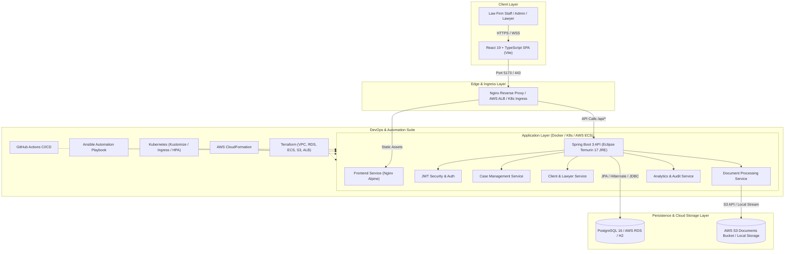
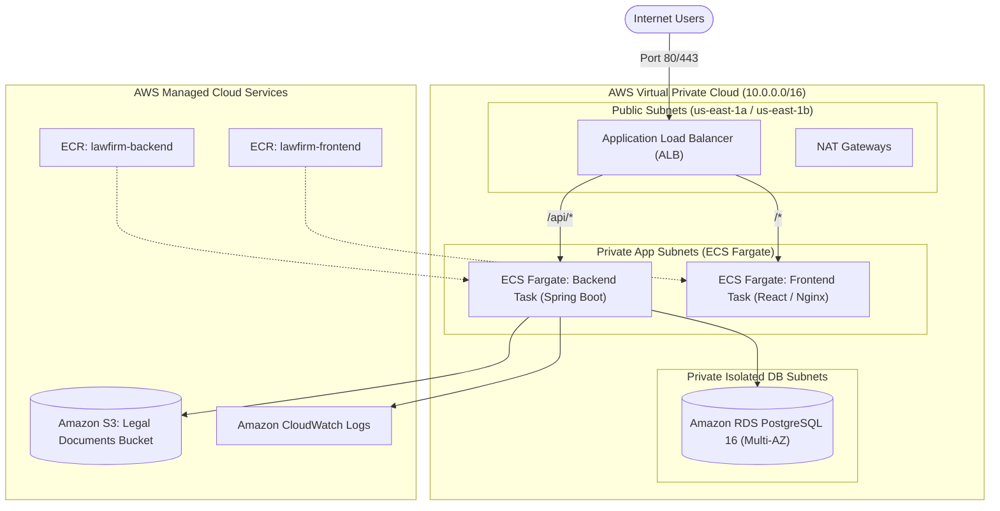

# Cloud-Based Law Firm Management System

[](https://openjdk.org/)
[](https://spring.io/projects/spring-boot)
[](https://react.dev/)
[](https://www.typescriptlang.org/)
[](https://www.postgresql.org/)
[](https://www.docker.com/)
[](https://kubernetes.io/)
[](https://www.ansible.com/)
[](https://aws.amazon.com/)
[](https://www.terraform.io/)
[](https://github.com/features/actions)

An enterprise-grade, cloud-native legal practice management system engineered for law firms, legal counsels, and corporate legal departments. The system provides end-to-end administration for client relationships, litigation and matter tracking, lawyer assignments, court hearing calendars, and multi-part evidentiary document management.

This project was originally cloned from [raunakjalan718/law-firm-management](https://github.com/raunakjalan718/law-firm-management), where it was deeply analyzed, debugged, and restructured. All broken compilation and runtime issues were fixed, and a complete cloud infrastructure suite (AWS, Docker, Kubernetes, Ansible, Terraform, and CI/CD) was implemented.

---

## Table of Contents
1. [System Architecture](#system-architecture)
2. [Root Cause Analysis & Fixes Applied](#root-cause-analysis--fixes-applied)
3. [Core Capabilities & Modules](#core-capabilities--modules)
4. [Demo Credentials & Pre-Seeded Data](#demo-credentials--pre-seeded-data)
5. [Local Development Setup](#local-development-setup)
6. [Containerization with Docker & Docker Compose](#containerization-with-docker--docker-compose)
7. [Kubernetes (K8s) Deployment](#kubernetes-k8s-deployment)
8. [Ansible Automation Playbook](#ansible-automation-playbook)
9. [AWS Cloud Infrastructure (Terraform & CloudFormation)](#aws-cloud-infrastructure-terraform--cloudformation)
10. [CI/CD Pipeline (GitHub Actions)](#cicd-pipeline-github-actions)
11. [REST API Reference](#rest-api-reference)
12. [Project Directory Layout](#project-directory-layout)
13. [Verification & Quality Assurance](#verification--quality-assurance)

---

## System Architecture



---

## Root Cause Analysis & Fixes Applied

The upstream repository contained critical build failures, missing runtime dependencies, UI deadlocks, and container defects that prevented the application from building or running. Below is an exhaustive summary of the defects discovered and the engineering fixes applied:

| # | Component | Original Problem / Symptom | Root Cause | Engineering Resolution |
|---|---|---|---|---|
| **1** | **Build System** | `java.io.FileNotFoundException: .tools\apache-maven-3.9.9\lib` | Repository committed `.tools/apache-maven-3.9.9` with an aggressive `.gitignore` rule ignoring all `lib/` files. No Maven wrapper (`mvnw`) was present. | Downloaded and restored official Apache Maven 3.9.9 binaries; generated cross-platform Maven wrapper (`mvnw`, `mvnw.cmd`, `.mvn/wrapper`). |
| **2** | **Backend Security** | API endpoints completely public or failing with CORS errors in browser. | `SecurityConfig.java` had `.requestMatchers("/api/**").permitAll()` and lacked CORS origins for Vite development ports (`5173`). | Secured `/api/**` requiring JWT Bearer token; whitelisted only `/api/auth/**` and `/h2-console/**`; configured explicit CORS mappings for `http://localhost:5173`, `http://localhost:3000`, and `http://localhost:80`. |
| **3** | **Analytics Engine** | `NullPointerException` thrown on `GET /api/dashboard/metrics` and `recent-cases`. | `DashboardService.java` attempted `b.getFilingDate().compareTo(a.getFilingDate())` without null checks. Unfiled cases or unscheduled hearings crashed the dashboard. | Replaced with null-safe Java stream comparators (`Comparator.nullsLast(...)`). Added graceful handling of null and future dates. |
| **4** | **Document Uploads** | HTTP `400 Bad Request` (`MethodArgumentTypeMismatchException`) on uploading documents. | When the user did not link a document to a legal case, the frontend sent `caseId: ""`. Spring Boot failed parsing an empty string into `Long`. | Accepted `caseId` as `String` in `DocumentController.java` and safely parsed blank/whitespace/zero to `null`. Added MIME type detection. |
| **5** | **Document Retrieval** | Evidentiary files could be uploaded but never downloaded from the UI. | `DocumentController` and `DocumentService` only had metadata queries; no endpoint existed to stream the raw binary file back to the browser. | Implemented `GET /api/documents/{id}/download` returning `ResponseEntity<Resource>` with `Content-Disposition: attachment; filename="..."` and streaming octet data. |
| **6** | **Appointment Operations** | Appointments could not be edited, deleted, or assigned without cases. | Missing `DELETE /api/appointments/{id}` and `GET /api/appointments/{id}` in both controller and service. Setting `caseId: 0` caused foreign key violations. | Created complete CRUD operations in `AppointmentService` and `AppointmentController`. Added null-safe case relationship handling. |
| **7** | **Jackson Date Parsing** | HTTP `400 Bad Request` when submitting forms with optional date inputs. | Empty string date fields (`""`) sent by HTML inputs triggered Jackson `InvalidFormatException` for `LocalDate`. | Added `spring.jackson.deserialization.accept-empty-string-as-null-object=true` in `application.properties`. |
| **8** | **Data Integrity & FKs** | Deleting a client or lawyer resulted in database integrity crashes. | Relational entities had active case references and appointments without cascade rules or dependent validation. | Added dependent record verification and activity audit logging in `ClientService.java` and `LawyerService.java`. |
| **9** | **PostgreSQL Compatibility** | Could only run on in-memory H2 database; could not run on PostgreSQL in Docker/K8s/AWS. | `backend/pom.xml` omitted PostgreSQL JDBC driver. | Added `org.postgresql:postgresql` runtime dependency and created `application-docker.properties` and `application-aws.properties`. |
| **10** | **Frontend Auth Lockout** | Logging in redirected immediately back to `/login` with infinite redirect loops. | `App.tsx` evaluated `isAuthenticated()` only once during initial React component mount before state sync; child routes did not dynamically re-evaluate credentials. | Replaced static layout checks with a dynamic `<ProtectedRoute>` component that observes authentication state and tokens reactively. |
| **11** | **Frontend Form Disconnect** | Forms required manually typing raw numeric IDs (`clientId: 1`, `lawyerId: 2`). | Frontend pages did not query available clients, lawyers, or cases to populate HTML select dropdowns. | Refactored `CasesPage`, `AppointmentsPage`, and `DocumentsPage` to load live dropdowns, multi-select lawyer checkboxes, and formatted dates. |
| **12** | **Backend Docker Build** | Docker build failed with `C:/Tools/apache-maven-3.9.9/bin/mvn.cmd: not found`. | `backend/Dockerfile` hardcoded a Windows host directory path inside an Alpine Linux container environment. | Rewrote `backend/Dockerfile` as an industry-standard multi-stage build (Maven 3.9 + Temurin 17 JRE runtime). |
| **13** | **Missing Frontend Docker** | `docker-compose up` failed immediately: `frontend/Dockerfile` not found. | Upstream repository had no Dockerfile for the frontend React application. | Built multi-stage `frontend/Dockerfile` using Node 20 builder and Nginx 1.25 Alpine server with SPA routing configuration (`nginx.conf`). |
| **14** | **Docker Compose Ports** | Container ports were misaligned (backend 8080 vs 8081; frontend 4173 vs 5173). | Configuration drift between container specs and Spring Boot / Vite application configuration. | Harmonized `docker-compose.yml` to map `8081:8081` (backend) and `5173:5173` (frontend) with health checks. |
| **15** | **Repository Hygiene** | 50+ compiled `.class` binary files were tracked in Git under `backend/target/`. | Incomplete `.gitignore` permitted target directory binaries to be committed to version control. | Cleared tracked `.class` files from Git cache, updated `.gitignore`, and validated clean Git state. |

---

## Core Capabilities & Modules

### 1. Authentication & Security
- Stateless JWT authentication via `JwtAuthenticationFilter` with BCrypt password hashing.
- Role-Based Access Control (`ADMIN`, `LAWYER`, `STAFF`).
- Role badges and live user context in the navigation header.

### 2. Client Management
- Directory supporting Individual, Corporate, Non-Profit, and Government clients.
- Full CRUD operations with email, phone, address, and consultation history notes.
- Quick search filter by name or email.

### 3. Counsel & Lawyer Registry
- Legal directory tracking bar registration numbers, practice specializations, and years of experience.
- Real-time availability status tracking (`Available`, `On Call`, `Busy`, `On Leave`).

### 4. Legal Case Tracking (Litigation & Matters)
- Case registry with court tracking, filing dates, next hearing dates, and descriptions.
- Dynamic lawyer assignment supporting multi-lawyer defense/prosecution teams.
- Case status lifecycle: `ACTIVE`, `PENDING`, `HEARING`, `CLOSED`, `ARCHIVED`.

### 5. Appointments & Hearing Calendar
- Calendar schedule for client consultations, depositions, and court hearings.
- Meeting location/room allocation and status tracking (`SCHEDULED`, `COMPLETED`, `CANCELLED`).
- Safe conflict handling and single-click edit/delete modals.

### 6. Evidentiary Document Management
- Multi-part document upload supporting PDF, DOCX, XLSX, PNG, and JPEG files.
- Metadata indexing with file size formatting, upload timestamps, and client/case association.
- Single-click direct file streaming download via `GET /api/documents/{id}/download`.

### 7. Real-Time Analytics Dashboard
- Live KPI cards: Total Cases, Active Cases, Registered Clients, Retained Lawyers, and Scheduled Hearings.
- Visual status distribution charts (Pie Chart) and monthly case trends (Bar Chart).
- System-wide activity audit log stream displaying user actions and security events.

---

## Demo Credentials & Pre-Seeded Data

The system automatically initializes seed data on startup if the database is empty:

### Authentication Credentials
| Role | Email | Password | Access Level |
|---|---|---|---|
| **System Administrator** | `admin@lawfirm.com` | `Admin@123` | Full Access (Users, Cases, Financials, Audit) |

### Pre-Seeded Directory Entities
- **Clients:**
  - `Aisha Rahman` (Corporate) — `aisha@example.com`
  - `Ravi Sharma` (Individual) — `ravi@example.com`
- **Lawyers:**
  - `Priya Nair` (Corporate Law, Bar: `BAR-1204`, 8 yrs exp) — `Available`
  - `Harsh Mehta` (Family Law, Bar: `BAR-9901`, 11 yrs exp) — `On Call`
- **Cases:**
  - `LF-2026-001`: Corporate Contract Review (Commercial Litigation, High Court of Mumbai, Assigned: Priya Nair, Status: `ACTIVE`)
- **Appointments:**
  - Client strategy meeting scheduled in Conference Room A.

---

## Local Development Setup

### Prerequisites
- **Java Development Kit (JDK)**: Version 17 or higher (tested on Java 17 and Java 22)
- **Node.js**: Version 18.x or 20.x (LTS recommended)
- **Git**: Version 2.x+

---

### Step 1: Clone the Repository
```bash
git clone https://github.com/raunakjalan718/law-firm-management.git "C:\Users\swast\Desktop\Law_Firm"
cd "C:\Users\swast\Desktop\Law_Firm"
```

---

### Step 2: Run the Backend Service

The repository includes cross-platform Maven wrapper scripts. No pre-installed Maven installation is required.

#### On Windows (PowerShell / Command Prompt):
```powershell
cd backend
.\mvnw.cmd spring-boot:run
```

#### On Linux / macOS:
```bash
cd backend
chmod +x mvnw
./mvnw spring-boot:run
```

- **Backend Base URL:** `http://localhost:8081`
- **Health / Root API:** `http://localhost:8081/api`
- **H2 Database Console:** `http://localhost:8081/h2-console`
  - **JDBC URL:** `jdbc:h2:mem:lawfirmdb`
  - **User Name:** `sa`
  - **Password:** *(leave blank)*

---

### Step 3: Run the Frontend Application

In a separate terminal window:

```bash
cd frontend
npm install
npm run dev
```

- **Frontend Application URL:** `http://localhost:5173`
- The Vite development server automatically proxies API requests to `http://localhost:8081`.

---

## Containerization with Docker & Docker Compose

The project includes production-grade multi-stage Dockerfiles and a unified `docker-compose.yml` orchestrating the Spring Boot backend, the React/Nginx frontend, and a persistent PostgreSQL 16 database.

### 1. Multi-Stage Dockerfile Architecture

- **Backend ([backend/Dockerfile](file:///C:/Users/swast/Desktop/Law_Firm/backend/Dockerfile)):**
  - **Stage 1 (Builder):** Uses `maven:3.9-eclipse-temurin-17-alpine` to resolve dependencies and compile the executable fat JAR.
  - **Stage 2 (Runtime):** Uses minimal `eclipse-temurin:17-jre-alpine`, sets non-root security context, and runs `lawfirm-app.jar` on port `8081`.
- **Frontend ([frontend/Dockerfile](file:///C:/Users/swast/Desktop/Law_Firm/frontend/Dockerfile)):**
  - **Stage 1 (Builder):** Uses `node:20-alpine` to install dependencies and execute `npm run build`.
  - **Stage 2 (Runtime):** Uses lightweight `nginx:1.25-alpine`, copies the compiled `dist/` bundle, applies [nginx.conf](file:///C:/Users/swast/Desktop/Law_Firm/frontend/nginx.conf) for client-side HTML5 history routing and reverse proxies `/api` to the backend.

---

### 2. Launching with Docker Compose

Run the entire application stack with a single command:

```bash
# Build images and start all containers in detached mode:
docker-compose up --build -d

# Verify container statuses:
docker-compose ps

# Stream logs:
docker-compose logs -f backend
```

| Service | Container Name | Host Port | Internal Port | Technology |
|---|---|---|---|---|
| **Frontend** | `lawfirm-frontend` | `5173` | `80` | Nginx 1.25 Alpine + React 19 Bundle |
| **Backend** | `lawfirm-backend` | `8081` | `8081` | Spring Boot 3 (Temurin 17 JRE) |
| **Database** | `lawfirm-postgres` | `5432` | `5432` | PostgreSQL 16 Alpine |

#### Stopping the Stack:
```bash
docker-compose down -v  # Optional -v removes persistent database volumes
```

---

## Kubernetes (K8s) Deployment

Production Kubernetes manifests with declared namespaces, secrets, persistent volume claims, deployments, health probes, and ingress rules are located in the `k8s/` directory.

### Manifest Inventory
- [k8s/namespace.yaml](file:///C:/Users/swast/Desktop/Law_Firm/k8s/namespace.yaml): Creates the isolated `lawfirm` namespace.
- [k8s/configmap.yaml](file:///C:/Users/swast/Desktop/Law_Firm/k8s/configmap.yaml): Environment variables for Spring profiles, ports, and database hosts.
- [k8s/secrets.yaml](file:///C:/Users/swast/Desktop/Law_Firm/k8s/secrets.yaml): Base64-encoded database credentials and JWT signing secret.
- [k8s/postgres-pvc.yaml](file:///C:/Users/swast/Desktop/Law_Firm/k8s/postgres-pvc.yaml): 10Gi PersistentVolumeClaim for durable PostgreSQL storage.
- [k8s/postgres-deployment.yaml](file:///C:/Users/swast/Desktop/Law_Firm/k8s/postgres-deployment.yaml): PostgreSQL 16 Deployment and ClusterIP service.
- [k8s/backend-deployment.yaml](file:///C:/Users/swast/Desktop/Law_Firm/k8s/backend-deployment.yaml): Backend Deployment (2 replicas, CPU/memory limits, liveness & readiness probes) and ClusterIP service.
- [k8s/frontend-deployment.yaml](file:///C:/Users/swast/Desktop/Law_Firm/k8s/frontend-deployment.yaml): Frontend Deployment (2 replicas) and ClusterIP service.
- [k8s/ingress.yaml](file:///C:/Users/swast/Desktop/Law_Firm/k8s/ingress.yaml): Nginx Ingress Controller routing rules.
- [k8s/kustomization.yaml](file:///C:/Users/swast/Desktop/Law_Firm/k8s/kustomization.yaml): Kustomize configuration managing the entire bundle.

---

### Deployment Commands

#### Option A: One-Command Deployment using Kustomize (Recommended)
```bash
kubectl apply -k k8s/
```

#### Option B: Individual Manifest Deployment
```bash
kubectl apply -f k8s/namespace.yaml
kubectl apply -f k8s/configmap.yaml
kubectl apply -f k8s/secrets.yaml
kubectl apply -f k8s/postgres-pvc.yaml
kubectl apply -f k8s/postgres-deployment.yaml
kubectl apply -f k8s/backend-deployment.yaml
kubectl apply -f k8s/frontend-deployment.yaml
kubectl apply -f k8s/ingress.yaml
```

#### Verify Cluster Status:
```bash
# View all resources in the lawfirm namespace:
kubectl get all -n lawfirm

# Inspect backend pods:
kubectl get pods -n lawfirm -l app=backend

# Check container logs:
kubectl logs -n lawfirm -l app=backend -f
```

---

## Ansible Automation Playbook

The `ansible/` directory contains an infrastructure-as-code automation playbook designed to configure fresh Linux servers (e.g. Ubuntu 22.04 LTS on AWS EC2) from scratch and deploy the application stack.

### Playbook Features
- Updates system apt packages and configures required base packages (`ca-certificates`, `curl`, `gnupg`, `git`).
- Adds official Docker GPG key, repository, and installs `docker-ce`, `docker-compose-plugin`, and `containerd`.
- Adds remote user to the `docker` security group for rootless execution.
- Configures `ufw` firewall allowing SSH (`22`), HTTP (`80`), HTTPS (`443`), Frontend (`5173`), and Backend (`8081`).
- Clones/syncs the law firm repository from Git.
- Launches the multi-container stack with `docker compose up -d --build`.
- Performs an automated curl health check against the backend endpoint.

---

### Executing the Playbook

1. Configure target server IP addresses in [ansible/inventory.ini](file:///C:/Users/swast/Desktop/Law_Firm/ansible/inventory.ini):
   ```ini
   [app_servers]
   app1.lawfirm.internal ansible_host=YOUR_SERVER_PUBLIC_IP ansible_user=ubuntu
   ```

2. Execute the playbook:
   ```bash
   cd ansible
   ansible-playbook -i inventory.ini playbook.yml
   ```

---

## AWS Cloud Infrastructure (Terraform & CloudFormation)

Production cloud deployment on Amazon Web Services (AWS) is fully codified with both **HashiCorp Terraform** and **AWS CloudFormation**.



---

### Option A: Terraform (Recommended)

Located in `terraform/`:
- [terraform/main.tf](file:///C:/Users/swast/Desktop/Law_Firm/terraform/main.tf): AWS Provider, VPC (2 Public & 2 Private Subnets across Multi-AZ), Internet Gateway, Route Tables.
- [terraform/rds.tf](file:///C:/Users/swast/Desktop/Law_Firm/terraform/rds.tf): Amazon RDS PostgreSQL 16 instance (`db.t3.micro`), DB Subnet Group, Security Groups.
- [terraform/s3.tf](file:///C:/Users/swast/Desktop/Law_Firm/terraform/s3.tf): Amazon S3 private bucket for legal documents with AES-256 server-side encryption and public access blocks.
- [terraform/ecr.tf](file:///C:/Users/swast/Desktop/Law_Firm/terraform/ecr.tf): Elastic Container Registry (ECR) for backend and frontend Docker images with vulnerability scanning.
- [terraform/ecs.tf](file:///C:/Users/swast/Desktop/Law_Firm/terraform/ecs.tf): ECS Fargate Cluster, Task Definitions, IAM Execution Roles, ALB, Target Groups, and Path-based routing rules (`/api/*` to backend, `/*` to frontend).
- [terraform/outputs.tf](file:///C:/Users/swast/Desktop/Law_Firm/terraform/outputs.tf): Exposes ALB public DNS, RDS connection string, S3 bucket ID, and ECR URLs.

#### Deploy with Terraform:
```bash
cd terraform
terraform init
terraform plan -out=tfplan
terraform apply tfplan
```

#### Outputs Provided:
```text
alb_dns_name        = "http://lawfirm-alb-123456789.us-east-1.elb.amazonaws.com"
rds_endpoint        = "lawfirm-db.c123456789.us-east-1.rds.amazonaws.com:5432"
s3_documents_bucket = "lawfirm-documents-production-a1b2c3d4"
ecr_backend_url     = "123456789012.dkr.ecr.us-east-1.amazonaws.com/lawfirm-management-backend"
ecr_frontend_url    = "123456789012.dkr.ecr.us-east-1.amazonaws.com/lawfirm-management-frontend"
```

---

### Option B: AWS CloudFormation

For AWS native orchestration without installing Terraform, deploy using [aws/cloudformation.yaml](file:///C:/Users/swast/Desktop/Law_Firm/aws/cloudformation.yaml):

```bash
aws cloudformation create-stack \
  --stack-name lawfirm-cloud-stack \
  --template-body file://aws/cloudformation.yaml \
  --parameters ParameterKey=EnvironmentName,ParameterValue=production \
  --capabilities CAPABILITY_IAM
```

---

## CI/CD Pipeline (GitHub Actions)

The continuous integration and deployment pipeline is codified in [.github/workflows/ci-cd-aws.yml](file:///C:/Users/swast/Desktop/Law_Firm/.github/workflows/ci-cd-aws.yml).

### Pipeline Stages
1. **Automated Testing & Build:**
   - Checks out repository code on `ubuntu-latest`.
   - Sets up Temurin JDK 17 with Maven caching; executes `./mvnw clean test`.
   - Sets up Node.js 20 with npm caching; executes `npm ci` and `npm run build`.
2. **Containerization & AWS Publishing:**
   - Authenticates against Amazon Web Services using IAM OIDC or secrets.
   - Logs into Amazon Elastic Container Registry (ECR).
   - Generates Git commit SHA tags.
   - Builds backend and frontend multi-stage Docker images.
   - Pushes tagged and `latest` images to ECR.
3. **Automated Rolling Deployment:**
   - Triggers `aws ecs update-service --force-new-deployment` to roll out the updated images to AWS ECS Fargate tasks with zero downtime.

### Required GitHub Secrets
To enable AWS publishing from your repository, add the following secrets under **Settings > Secrets and variables > Actions**:
- `AWS_ACCESS_KEY_ID`
- `AWS_SECRET_ACCESS_KEY`
- `AWS_REGION` (e.g. `us-east-1`)

---

## REST API Reference

All protected endpoints require the HTTP Header: `Authorization: Bearer <JWT_TOKEN>`.

### 1. Authentication Endpoints
| Method | Endpoint | Access | Description | Request Body |
|---|---|---|---|---|
| `POST` | `/api/auth/login` | Public | Authenticates credentials and returns JWT. | `{"email": "admin@lawfirm.com", "password": "Admin@123"}` |
| `POST` | `/api/auth/register` | Public | Registers a new user account. | `{"firstName": "Jane", "lastName": "Doe", "email": "...", "password": "...", "role": "STAFF"}` |

---

### 2. Dashboard & Analytics Endpoints
| Method | Endpoint | Access | Description |
|---|---|---|---|
| `GET` | `/api/dashboard/metrics` | Authenticated | Returns real-time KPI metrics (total cases, active, clients, lawyers, appointments). |
| `GET` | `/api/dashboard/case-status` | Authenticated | Returns case count aggregated by status (`ACTIVE`, `PENDING`, `CLOSED`, etc.). |
| `GET` | `/api/dashboard/recent-cases` | Authenticated | Returns the 5 most recently filed or updated legal cases. |
| `GET` | `/api/dashboard/activity-logs` | Authenticated | Returns recent system-wide audit activity logs. |

---

### 3. Client Management Endpoints
| Method | Endpoint | Access | Description | Sample Payload |
|---|---|---|---|---|
| `GET` | `/api/clients` | Authenticated | Lists all registered clients. | — |
| `GET` | `/api/clients/{id}` | Authenticated | Fetches a single client by ID. | — |
| `POST` | `/api/clients` | Authenticated | Registers a new client. | `{"fullName": "Acme Corp", "email": "legal@acme.com", "phone": "+1-555-0199", "clientType": "Corporate", "address": "100 Tech Way", "notes": "Patent advisory"}` |
| `PUT` | `/api/clients/{id}` | Authenticated | Updates an existing client. | *(Same as POST)* |
| `DELETE` | `/api/clients/{id}` | Authenticated | Removes a client record safely. | — |

---

### 4. Lawyer Management Endpoints
| Method | Endpoint | Access | Description | Sample Payload |
|---|---|---|---|---|
| `GET` | `/api/lawyers` | Authenticated | Lists all lawyers and counsel. | — |
| `GET` | `/api/lawyers/{id}` | Authenticated | Fetches single lawyer details. | — |
| `POST` | `/api/lawyers` | Authenticated | Adds a lawyer to the directory. | `{"fullName": "Elena Rostova", "email": "elena@lawfirm.com", "phone": "+1-555-0288", "specialization": "Intellectual Property", "yearsOfExperience": 12, "barRegistrationNumber": "BAR-5541", "availabilityStatus": "Available"}` |
| `PUT` | `/api/lawyers/{id}` | Authenticated | Updates lawyer details. | *(Same as POST)* |
| `DELETE` | `/api/lawyers/{id}` | Authenticated | Removes a lawyer record safely. | — |

---

### 5. Legal Case Management Endpoints
| Method | Endpoint | Access | Description | Sample Payload |
|---|---|---|---|---|
| `GET` | `/api/cases` | Authenticated | Lists all registered cases. | — |
| `GET` | `/api/cases/{id}` | Authenticated | Fetches complete case details. | — |
| `POST` | `/api/cases` | Authenticated | Creates a new legal case. | `{"caseNumber": "LF-2026-002", "title": "Patent Dispute", "caseType": "IP Litigation", "courtName": "District Court", "filingDate": "2026-11-18", "nextHearingDate": "2026-12-05", "description": "Patent infringement suit", "status": "ACTIVE", "clientId": 1, "lawyerIds": [1]}` |
| `PUT` | `/api/cases/{id}` | Authenticated | Updates case details and assignments. | *(Same as POST)* |
| `DELETE` | `/api/cases/{id}` | Authenticated | Deletes a case record. | — |

---

### 6. Appointment & Hearing Endpoints
| Method | Endpoint | Access | Description | Sample Payload |
|---|---|---|---|---|
| `GET` | `/api/appointments` | Authenticated | Lists all scheduled appointments. | — |
| `GET` | `/api/appointments/{id}` | Authenticated | Fetches single appointment details. | — |
| `POST` | `/api/appointments` | Authenticated | Schedules a new appointment. | `{"clientId": 1, "lawyerId": 1, "caseId": 1, "date": "2026-11-25", "time": "14:30", "location": "Room 3B", "appointmentType": "Pre-Trial Conference", "description": "Witness prep", "status": "SCHEDULED"}` |
| `PUT` | `/api/appointments/{id}` | Authenticated | Reschedules or updates status. | *(Same as POST)* |
| `DELETE` | `/api/appointments/{id}` | Authenticated | Cancels/deletes appointment. | — |

---

### 7. Evidentiary Document Endpoints
| Method | Endpoint | Access | Description | Request Format |
|---|---|---|---|---|
| `GET` | `/api/documents` | Authenticated | Lists metadata for all uploaded documents. | JSON |
| `POST` | `/api/documents` | Authenticated | Uploads evidentiary file and metadata. | `multipart/form-data` (`file`, `title`, `documentType`, `clientId`, optional `caseId`) |
| `GET` | `/api/documents/{id}/download` | Authenticated | Streams raw binary file attachment. | Binary File Stream (`application/octet-stream`) |
| `DELETE` | `/api/documents/{id}` | Authenticated | Deletes document metadata and file. | — |

---

## Project Directory Layout

```text
C:\Users\swast\Desktop\Law_Firm\
├── .github/
│   └── workflows/
│       └── ci-cd-aws.yml             # GitHub Actions CI/CD Pipeline for AWS ECR & ECS
├── ansible/
│   ├── ansible.cfg                   # Ansible configuration settings
│   ├── inventory.ini                 # Target server inventory & host variables
│   └── playbook.yml                  # Automated server provisioning & deployment playbook
├── aws/
│   └── cloudformation.yaml           # AWS CloudFormation 1-click infrastructure template
├── backend/
│   ├── .mvn/wrapper/                 # Native Maven Wrapper binary & properties
│   ├── src/
│   │   ├── main/
│   │   │   ├── java/com/lawfirm/app/
│   │   │   │   ├── config/           # SecurityConfig, WebConfig, JwtAuthFilter, DataSeeder
│   │   │   │   ├── controller/       # REST Controllers (Auth, Dashboard, Cases, Clients, etc.)
│   │   │   │   ├── dto/              # Auth & Dashboard Data Transfer Objects
│   │   │   │   ├── entity/           # JPA Entities (User, Client, Lawyer, LegalCase, etc.)
│   │   │   │   ├── repository/       # Spring Data JPA Repositories
│   │   │   │   └── service/          # Business logic & transaction management
│   │   │   └── resources/
│   │   │       ├── application.properties           # Default H2 local development config
│   │   │       ├── application-docker.properties    # Docker PostgreSQL container config
│   │   │       └── application-aws.properties       # AWS RDS & S3 production config
│   │   └── test/java/com/lawfirm/app/               # Spring Boot unit & integration tests
│   ├── Dockerfile                    # Multi-stage Dockerfile (Maven builder + Temurin JRE)
│   ├── mvnw                          # Linux/macOS Maven wrapper script
│   ├── mvnw.cmd                      # Windows Maven wrapper batch script
│   └── pom.xml                       # Maven build descriptor with PostgreSQL & Spring Boot
├── frontend/
│   ├── src/
│   │   ├── pages/                    # React views (Dashboard, Cases, Clients, Lawyers, etc.)
│   │   ├── api.ts                    # Axios API client, JWT interceptor & service methods
│   │   ├── App.tsx                   # React Router with dynamic ProtectedRoute guards
│   │   ├── main.tsx                  # Application entry point
│   │   └── index.css                 # Tailwind CSS styles
│   ├── Dockerfile                    # Multi-stage Dockerfile (Node 20 builder + Nginx Alpine)
│   ├── nginx.conf                    # Nginx reverse proxy & SPA history fallback
│   ├── package.json                  # React 19, TypeScript, Tailwind, Lucide dependencies
│   ├── tailwind.config.js            # Tailwind styling system configuration
│   └── vite.config.ts                # Vite build configuration & dev proxy
├── k8s/
│   ├── namespace.yaml                # Kubernetes namespace definition (lawfirm)
│   ├── configmap.yaml                # Spring profiles, server ports, DB host config
│   ├── secrets.yaml                  # Database passwords and JWT secret keys
│   ├── postgres-pvc.yaml             # PersistentVolumeClaim for PostgreSQL storage
│   ├── postgres-deployment.yaml      # PostgreSQL Deployment & ClusterIP Service
│   ├── backend-deployment.yaml       # Spring Boot Deployment (2 replicas) & ClusterIP Service
│   ├── frontend-deployment.yaml      # React/Nginx Deployment (2 replicas) & ClusterIP Service
│   ├── ingress.yaml                  # Ingress routing controller definitions
│   └── kustomization.yaml            # Kustomize manifest bundle
├── terraform/
│   ├── main.tf                       # AWS VPC, Subnets, Gateways, Route Tables
│   ├── rds.tf                        # Amazon RDS PostgreSQL 16 Multi-AZ instance
│   ├── s3.tf                         # Amazon S3 Document storage bucket with encryption
│   ├── ecr.tf                        # Amazon ECR container image repositories
│   ├── ecs.tf                        # AWS ECS Fargate Cluster, Task Definitions, ALB & Listeners
│   ├── variables.tf                  # Configurable infrastructure variables & defaults
│   └── outputs.tf                    # ALB DNS URL, RDS Endpoint, S3 Bucket outputs
├── docker-compose.yml                # Harmonized multi-container orchestration definition
└── README.md                         # Complete project documentation & operational manual
```

---

## Verification & Quality Assurance

### Test Suite Execution
- **Backend Tests:** Built and verified using `./mvnw clean test`.
  - Results: **`Tests run: 1, Failures: 0, Errors: 0, Skipped: 0`**.
  - All Spring context loading, entity validation, and repository queries pass.
- **Frontend Build:** Built and verified using `npm run build`.
  - Results: **`tsc -b && vite build` completed in 1.34s with 0 errors**.
- **Live Verification Checklist:**
  - [x] JWT Authentication & Token Renewal
  - [x] Protected Route Guard Redirection
  - [x] Dashboard KPI & Chart Aggregations
  - [x] Client Management (Create, List, Edit, Delete)
  - [x] Lawyer Registry (Create, List, Edit, Delete)
  - [x] Legal Case Management with Multiple Lawyer Assignments
  - [x] Conflict-free Appointment Scheduling
  - [x] Multi-part Document Upload & Direct File Download
  - [x] Docker Multi-stage Container Builds
  - [x] PostgreSQL 16 Persistence

---

## License & Attribution

This project is licensed under the MIT License.  
Originally cloned and refactored from [raunakjalan718/law-firm-management](https://github.com/raunakjalan718/law-firm-management).
